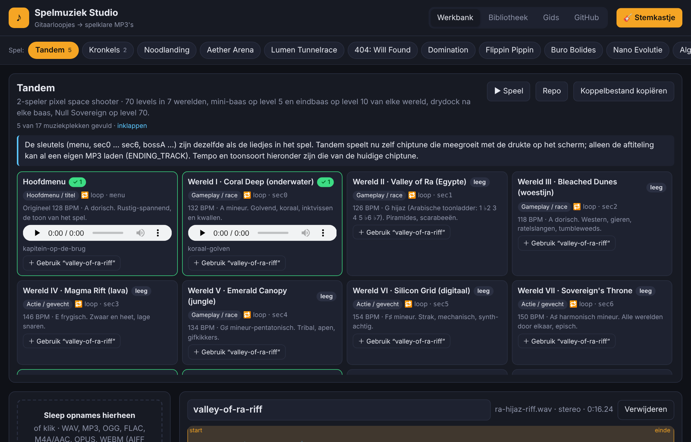
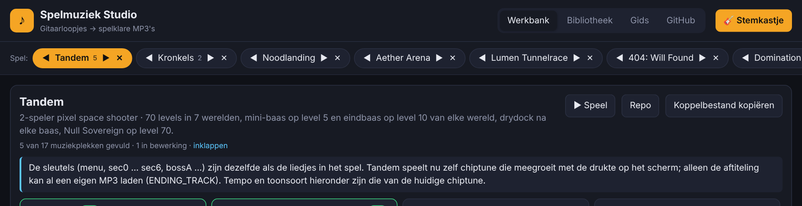
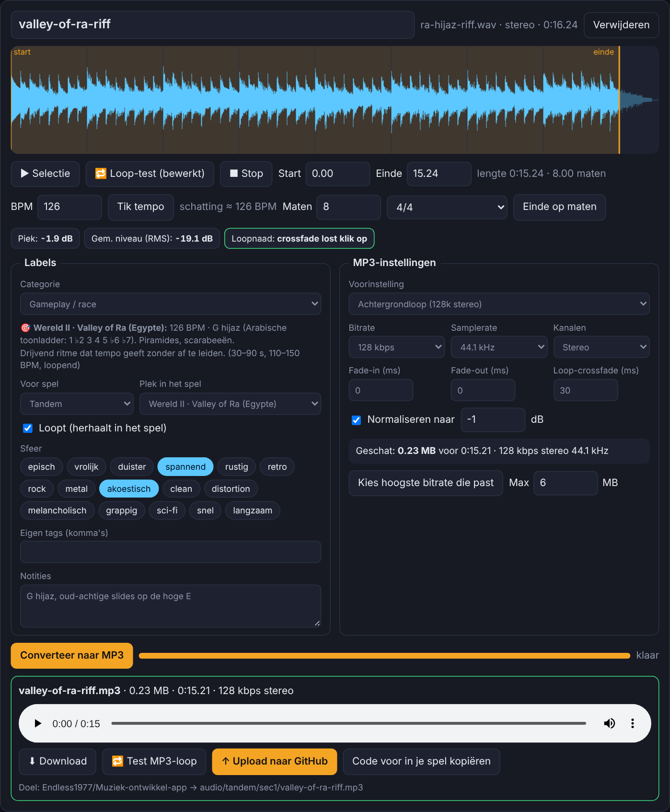
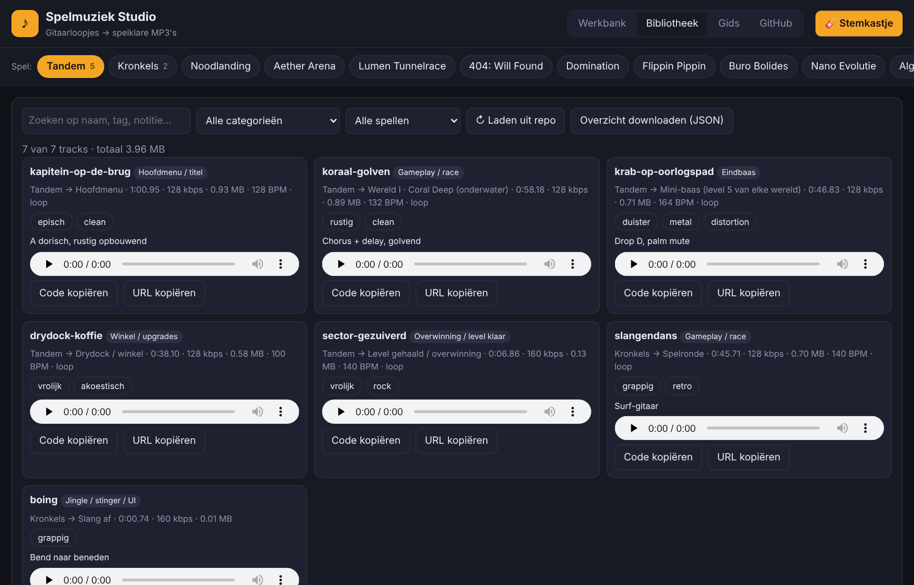
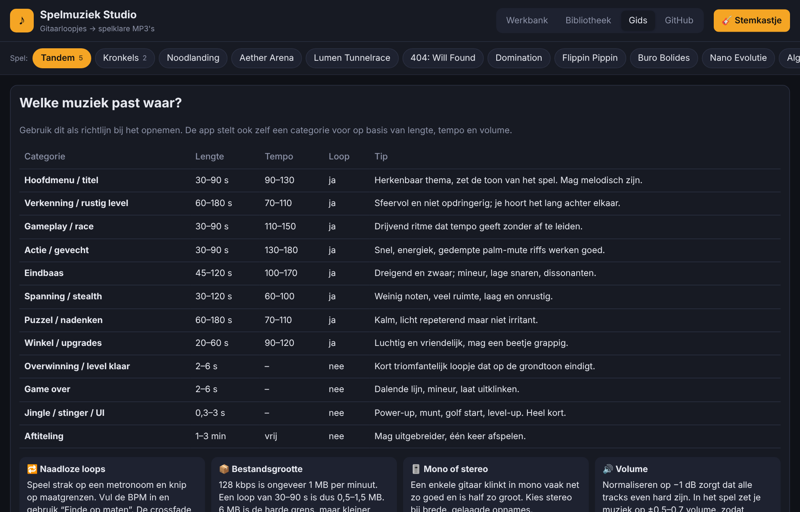
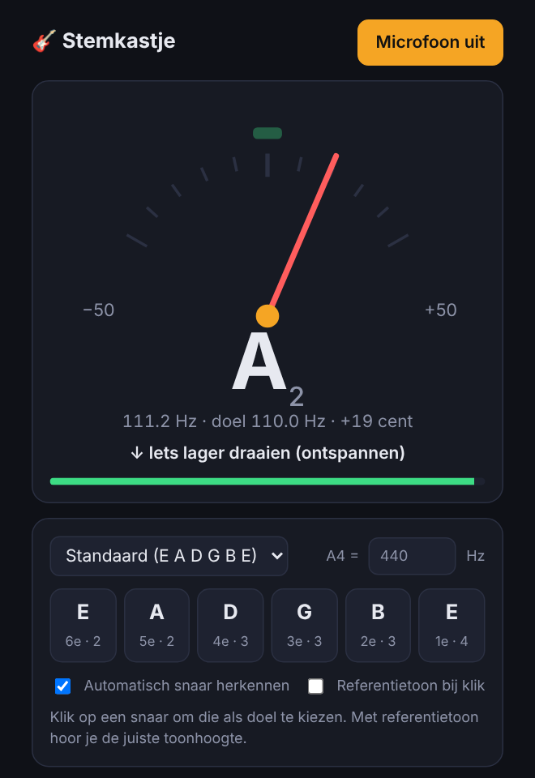
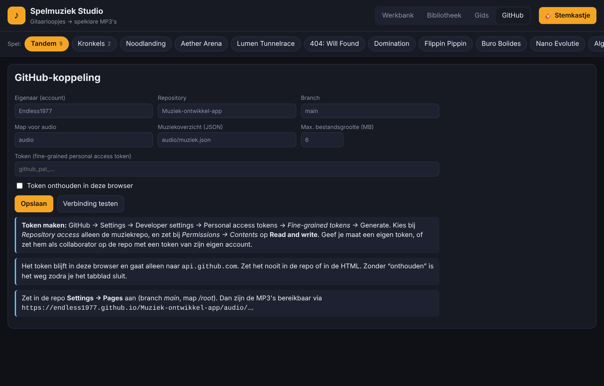
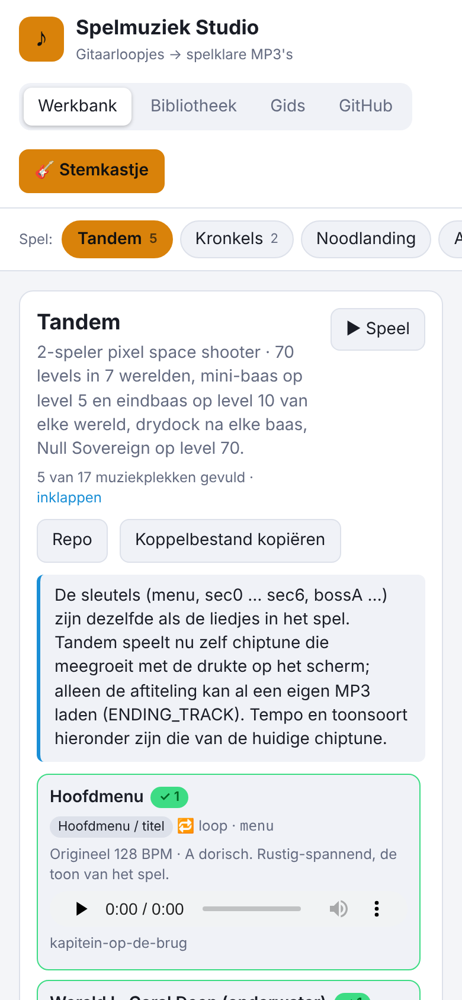

# Muziek-ontwikkel-app — Spelmuziek Studio

Webapp om gitaaropnames om te zetten in korte, loopende MP3's voor mijn HTML-spellen. Je kiest per spel welke muziek het nodig heeft, knipt en zet de opname om, en uploadt hem rechtstreeks naar deze repo. Alles draait in de browser, zonder server.

**Openen:** https://endless1977.github.io/Muziek-ontwikkel-app/

## Snel aan de slag

1. Open de app en kies bovenin het **spel** waarvoor je muziek maakt.
2. Sleep een opname (WAV, MP3, OGG, FLAC, M4A …) in het vak links.
3. Klik in het spelplan bij de juiste plek op **＋ Gebruik**. Categorie, loop en MP3-instellingen worden dan vanzelf goed gezet.
4. Knip op de golfvorm, vul de BPM in en klik **Einde op maten** voor een loop die precies klopt.
5. **Converteer naar MP3**, luister met **Test MP3-loop** of de naad klopt, en klik **Upload naar GitHub**.

## Een tab per spel

Elk spel heeft een eigen tab: Tandem, Kronkels, Noodlanding, Aether Arena, Lumen Tunnelrace, 404: Will Found, Domination, Flippin Pippin, Buro Bolides en Nano Evolutie. Daarnaast is er **Algemeen** voor muziek die nog nergens bij hoort. Het getal op een tab is het aantal geüploade tracks.

**Volgorde aanpassen:** sleep een tab naar een andere plek, of klik **↔ Volgorde** en gebruik ◀ ▶. Met ✕ verberg je een spel en met 👁 haal je het terug. **Standaardvolgorde** zet alles terug. De volgorde wordt per browser onthouden.

## Spelplan

Bovenaan de werkbank staat voor het gekozen spel welke muziek het nodig heeft, welke plekken al gevuld zijn (✓) en welke nog leeg zijn. Een geüploade track kun je daar direct beluisteren.

**Tandem** heeft 17 plekken, met dezelfde namen als de liedjes in het spel:

| Plek | Wat | Huidige chiptune |
|---|---|---|
| `menu` | Hoofdmenu | 128 BPM · A dorisch |
| `sec0` | Wereld I · Coral Deep (onderwater) | 132 BPM · A mineur |
| `sec1` | Wereld II · Valley of Ra (Egypte) | 126 BPM · G hijaz |
| `sec2` | Wereld III · Bleached Dunes (woestijn) | 118 BPM · A dorisch |
| `sec3` | Wereld IV · Magma Rift (lava) | 146 BPM · E frygisch |
| `sec4` | Wereld V · Emerald Canopy (jungle) | 134 BPM · G♯ pentatonisch |
| `sec5` | Wereld VI · Silicon Grid (digitaal) | 154 BPM · F♯ mineur |
| `sec6` | Wereld VII · Sovereign's Throne | 150 BPM · A♯ harmonisch mineur |
| `shop` | Drydock / winkel | 100 BPM · C majeur |
| `bossA` | Mini-baas (level 5 van elke wereld) | 164 BPM · E frygisch |
| `bossB` | Eindbaas (level 10 van elke wereld) | 170 BPM · D harmonisch mineur |
| `super1` | Null Sovereign · faraomasker (level 70) | 176 BPM · D♯ harmonisch mineur |
| `super2` | Null Sovereign · Ascendant (2e leven) | 190 BPM · E frygisch |
| `tf` | Transformatie (bevroren beeld) | 60 BPM drone |
| `win` | Level gehaald / overwinning | 140 BPM · C majeur |
| `over` | Game over (eenmalig) | 84 BPM · A mineur |
| `ending` | Aftiteling / eindfanfare | fanfare |

Tandem speelt nu nog zijn eigen chiptune. Alleen de aftiteling kan al een eigen MP3 laden: zet in Tandem `ENDING_TRACK` op het MP3-adres.

Met **Koppelbestand kopiëren** krijg je per spel een JSON met per plek het MP3-adres en de looppunten. Daarmee kan een spel de muziek laden.

## Werkbank: knippen, labelen en omzetten

- **Knippen**: sleep start en einde op de golfvorm. Met BPM (zelf invullen, meetikken of de schatting van de app) en **Einde op maten** knip je precies op de maat.
- **Controle**: de app toont piek, gemiddeld niveau en clipping, en waarschuwt als de loopnaad gaat klikken.
- **Labels**: categorie, spel, plek, sfeertags en notities. De app stelt zelf een categorie voor op basis van lengte, tempo en volume.
- **MP3-instellingen**:
  - voorinstellingen (achtergrondloop, klein/mobiel, hoge kwaliteit, jingle, superklein);
  - bitrate 64–320 kbps, samplerate, mono of stereo;
  - fade-in en fade-out, loop-crossfade en normaliseren.
- **Grootte**: je ziet vooraf hoe groot het bestand wordt. De grens staat standaard op 6 MB, en **Kies hoogste bitrate die past** zoekt de beste kwaliteit binnen die grens.
- **Naadloze loops**: de crossfade haalt de klik weg. De app meet ook de vertraging die de MP3-encoder toevoegt en slaat de looppunten op. De code die je kopieert gebruikt die looppunten, zodat de loop zonder gat herhaalt.
- **Alles converteren** en **Alles uploaden** werken voor meerdere opnames tegelijk.

MP3's komen in `audio/<spel>/<plek>/<naam>.mp3`. Het overzicht van alle tracks staat in `audio/muziek.json`.

## Bibliotheek

Alle geüploade muziek, te filteren op spel, categorie en zoekterm, met afspelen, **Code kopiëren** (kant-en-klare JavaScript voor in je spel) en **URL kopiëren**.

*De tracks op de schermafbeeldingen zijn voorbeelddata.*

## Gids

Een overzicht van welke muziek waar past: lengte, tempo, wel of geen loop, en tips. Bijvoorbeeld voor naadloze loops, bestandsgrootte, mono of stereo, volume en autoplay in de browser.

## Stemkastje

De knop **🎸 Stemkastje** opent een stemapparaat in een pop-up. Als pop-ups geblokkeerd zijn, opent het in een nieuw tabblad. Het stemkastje heeft:
- een naald met centen-afwijking;
- automatische snaarherkenning;
- 8 stemmingen (standaard, Drop D, E♭, D standaard, Drop C, Open G, Open D, DADGAD);
- een referentietoon;
- instelbare A4 (415–466 Hz).

## GitHub-koppeling instellen

1. Maak een fine-grained token via GitHub → **Settings** → **Developer settings** → **Personal access tokens** → **Fine-grained tokens** → **Generate new token**. Of ga direct naar https://github.com/settings/personal-access-tokens/new.
2. Kies bij *Repository access* **Only select repositories** → `Muziek-ontwikkel-app`.
3. Zet bij *Permissions* **Contents** op **Read and write**.
4. Klik **Generate token** en kopieer de code (`github_pat_…`). GitHub laat hem maar één keer zien.
5. Open in de app de tab **GitHub**, plak het token, klik **Opslaan** en dan **Verbinding testen**.

Het token blijft in je browser en gaat alleen naar `api.github.com`. Zet het nooit in deze repo of in een chat. Een medewerker kan het best een eigen GitHub-account gebruiken: nodig die uit via **Settings → Collaborators**, en laat hem een eigen token maken.

## Ook op de telefoon

## Bestanden

| Bestand | Wat |
|---|---|
| `index.html` | De app |
| `stemkastje.html` | Het stemkastje |
| `audio/` | Geüploade MP3's en `muziek.json` (verschijnt na de eerste upload) |
| `docs/screenshots/` | Afbeeldingen voor deze README |

De MP3-encoder is [lamejs](https://github.com/zhuker/lamejs), geladen van cdnjs.
